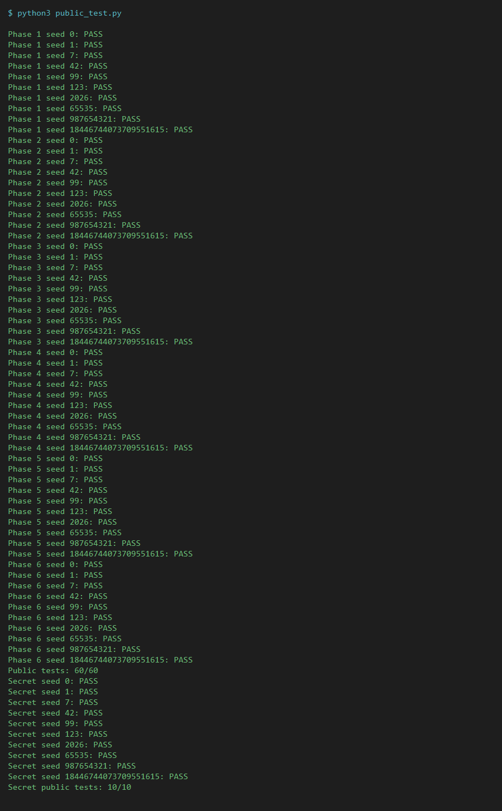
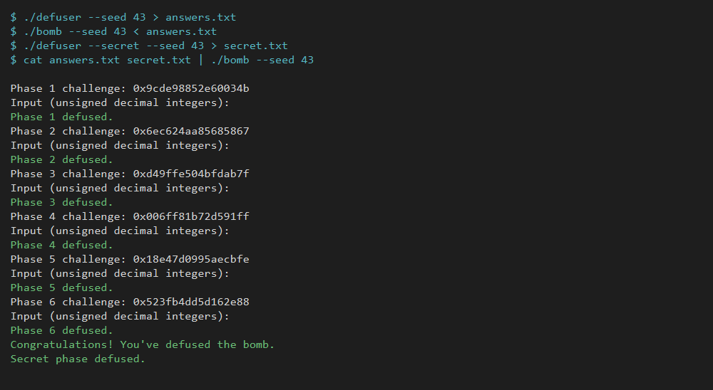
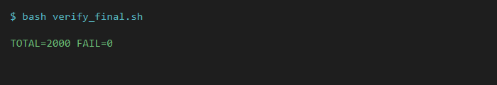

# 计算机系统基础 Lab2：BombLab 实验报告

- 日期：2026-10-30
- 实验环境：WSL2 Ubuntu 26.04.1 LTS，Linux x86_64
- 工具链：GCC 15.2.0、GNU Make 4.4.1、Python 3.14.4、GDB 17.1、binutils 2.46

## 1. 实验目标

`bomb` 是一个没有源码的 x86-64 ELF 程序。程序在每一关打印一个 64 位 `challenge`，然后等待一行由若干无符号十进制整数组成的口令。口令不是固定字符串，而是由 `challenge` 经过该关内部的运算得到；换一个 `seed` 或 `--challenge`，题目和答案都会变化。

实验要求只修改 `defuser.c`，为第 1～6 关和 Honor 关分别实现：

```c
int solve_phase_N(uint64_t challenge, char *out, size_t cap);
int solve_secret(uint64_t challenge, uint64_t context, char *out, size_t cap);
```

本报告记录从 `bomb` 的反汇编恢复计算关系的过程，以及用多个公开/非公开 seed 验证的结果。

## 2. 分析方法

### 2.1 静态分析

用 `objdump` 按函数导出汇编，先读控制流和关键比较，再回到 GDB 核对运行时值：

```bash
objdump -d --no-show-raw-insn --disassemble=phase_01 ./bomb
objdump -d --no-show-raw-insn --disassemble=p1_compute ./bomb
gdb ./bomb
(gdb) break *phase_01
(gdb) run --seed 43 --phase 1 < input.txt
(gdb) x/s $rdi
(gdb) p/x $rsi
```

`bomb` 未剥离符号表，`phase_01`～`phase_06`、`p1_compute`、`p3_dispatch`、`p4_walk`、`p5_traverse`、`p6_dispatch`、`secret_gate`、`secret_phase` 等函数名可以直接从 `nm`/`objdump` 读出。

### 2.2 challenge 的生成

`challenge_from_seed`（0x4027c0）就是 splitmix64：

```text
challenge(seed, p) = splitmix64(seed + (p + 1) * 0x9e3779b97f4a7c15)

splitmix64(z):
    z ^= z >> 30; z *= 0xbf58476d1ce4e5b9
    z ^= z >> 27; z *= 0x94d049bb133111eb
    z ^= z >> 31
```

`--seed S` 时每关用上式算出自己的 challenge；`--challenge X --phase N` 则直接固定 challenge，适合反复调试同一组输入。Honor 的 challenge 用 `p = 7` 计算，但不会打印。

### 2.3 输入格式

第 1～6 关的输入由 `valid_u32_fields(s, n)`（0x402c70）检查：恰好 `n` 个十进制整数，每个在 `0..UINT32_MAX` 内，字段之间允许空白，行尾只能是空白，不能有多余字符；`bomb` 读入的行最多 255 字节且不能为空。`sscanf` 的格式串在 `.rodata` 中，例如 `"%u %u"`、`"%u %u %u %u %u %u"`，据此可以确认每关字段数。

### 2.4 运算宽度

汇编里大量使用 32 位寄存器（`eax`、`edi`、`esi` 等）。所有加减乘都按 2³² 回绕，右移是 `uint32_t` 的逻辑右移。因此在 `defuser.c` 中统一用 `uint32_t` 保存中间值，避免 `int`/`uint64_t` 提升改变高位结果。

## 3. 第 1 关：函数调用与线性变换

### 3.1 关键汇编

```asm
0000000000402020 <p1_step0>:
  402024: sub    %esi,%edi
  402026: lea    0xb564(%rdi,%rdi,4),%eax     # (a-b)*5 + 0xb564
  40202d: ret

0000000000402030 <p1_step1>:
  402034: lea    (%rdi,%rdi,2),%eax            # 3*a
  402037: add    %esi,%eax                     # + b
  402039: xor    $0x2ec7,%eax
  40203e: ret

0000000000402040 <p1_step2>:
  402044: lea    0x63f2(%rsi),%eax             # b + 0x63f2
  40204a: xor    %edi,%eax                     # ^ a
  40204c: ret

0000000000402050 <p1_compute>:
  402055: mov    %rdi,%rdx
  402058: mov    %rdi,%rax
  40205b: shr    $0x20,%rax                    # hi = ch >> 32
  40205f: mov    %rdx,%rsi
  402062: mov    %eax,%edi                     # 第 1 个参数 = hi
  402064: shr    $0x10,%rsi                    # 第 2 个参数 = ch >> 16
  40206b: call   402030 <p1_step1>
  402070: mov    %edi,%esi                     # 第 2 个参数 = hi
  402072: mov    %edx,%edi                     # 第 1 个参数 = (uint32_t)ch
  402074: mov    %eax,%ecx                     # 暂存 s1
  402076: call   402020 <p1_step0>
  40207b: mov    %ecx,%esi                     # 第 2 个参数 = s1
  40207d: mov    %eax,%edi                     # 第 1 个参数 = s0
  40207f: call   402040 <p1_step2>
```

### 3.2 推理

`p1_compute` 先保存 `ch` 的低 32 位到 `edx`、高 32 位到 `eax`。三次调用的参数顺序为：

1. `p1_step1(hi, (uint32_t)(ch >> 16))`，结果记为 `s1`；
2. `p1_step0((uint32_t)ch, hi)`，结果记为 `s0`；
3. `p1_step2(s0, s1)`，即 `(s1 + 0x63f2) ^ s0`。

结合三个 helper 的指令，得到：

```text
lo = (uint32_t)ch
hi = (uint32_t)(ch >> 32)
s1 = (3*hi + (uint32_t)(ch >> 16)) ^ 0x2ec7
s0 = (lo - hi) * 5 + 0xb564
ans = (s1 + 0x63f2) ^ s0
```

第 1 关只需要 1 个字段。以非公开 seed 43 为例：

```text
ch = 0x9cde98852e60034b
lo = 0x2e60034b, hi = 0x9cde9885
s1 = 0x6f20d928, s0 = 0xd787cb42
ans = 0xb8a6f658 = 3097949784
```

把 `3097949784` 输入第 1 关，输出 `Phase 1 defused.`。

## 4. 第 2 关：数组、循环与递推

### 4.1 关键汇编

```asm
00000000004020f0 <phase_02>:
  40215a: mov    %r13,%rax
  40215d: mov    -0x40(%rbp),%esi          # f[0]
  402160: shr    $0x11,%rax                # ch >> 17
  402164: and    $0x1f,%eax                # 取低 5 位
  402167: xor    $0x19,%eax
  40216a: cmp    %eax,%esi
  40216c: jne    fail
  40216e: mov    $0x19,%ecx                # 移位量初值 25
  402173: mov    $0x1,%edx                 # i = 1
  402178: mov    %r13,%rax
  40217b: lea    (%rsi,%rsi,4),%esi          # 5 * f[i-1]
  40217e: shr    %cl,%rax                   # ch >> (25 + 4*(i-1))
  402181: and    $0x3f,%eax                 # 取低 6 位
  402184: add    %edx,%eax                  # + i
  402186: xor    %esi,%eax                  # ^ 5*f[i-1]
  402188: mov    -0x40(%rbp,%rdx,4),%esi    # f[i]
  40218c: cmp    %eax,%esi
  40218e: jne    fail
  402190: add    $0x1,%rdx
  402194: add    $0x4,%ecx                  # 移位量每次 +4
  402197: cmp    $0x6,%rdx
  40219b: jne    402178
```

### 4.2 推理

`phase_02` 先检查 `f[0]`，再进入 5 次循环。循环中 `ecx` 从 25 开始，每次加 4，正好是 `25 + 4*(i-1)`；`edx` 是当前下标 `i`。因此：

```text
f[0] = ((ch >> 17) & 0x1f) ^ 0x19
f[i] = (((ch >> (25 + 4*(i-1))) & 0x3f) + i) ^ (5 * f[i-1])   (i = 1..5)
```

共 6 个字段。seed 43 时 challenge 为 `0x6ec624aa85685867`，算得：

```text
13 66 348 1748 8717 43606
```

输入后输出 `Phase 2 defused.`。

## 5. 第 3 关：switch 与跳转表

### 5.1 关键汇编

```asm
00000000004022b0 <phase_03>:
  4022fc: mov    %r12d,%edi
  402301: and    $0x7,%edi                # idx = ch & 7
  402304: cmp    %edi,-0x18(%rbp)          # 第 1 个输入
  402307: jne    fail
  402309: mov    %r12,%rax
  40230c: mov    %r12,%rsi
  40230f: shr    $0x3,%rax                 # ch >> 3
  402313: shr    $0x20,%rsi                # ch >> 32
  402317: xor    %eax,%esi                 # arg = (ch>>32) ^ (ch>>3)
  402319: call   402250 <p3_dispatch>
  40231e: cmp    %eax,-0x14(%rbp)           # 第 2 个输入
  402321: sete   %al

0000000000402250 <p3_dispatch>:
  402254: mov    %edi,%eax                 # idx
  402256: mov    %esi,%edi                 # arg
  402258: cmp    $0x7,%eax
  40225b: ja     4022a5
  40225d: notrack jmp *0x405820(,%rax,8)    # 8 项函数指针表
```

`0x405820` 处的表内容（按索引 0～7）为：

```text
0x402278 p3_case_1    0x402280 p3_case_0
0x402288 p3_case_5    0x402290 p3_case_4
0x402298 p3_case_2    0x4022a0 p3_case_3
0x402268 p3_case_6    0x402270 p3_case_7
```

### 5.2 推理与分支表

第 1 个字段是下标 `idx = ch & 7`，第 2 个字段是 `idx` 对应函数作用在

```text
arg = (uint32_t)(ch >> 32) ^ (uint32_t)(ch >> 3)
```

上的结果。8 个分支的函数体很短，恢复为：

| idx | 表项 | 公式 |
|---:|---|---|
| 0 | `p3_case_1` | `3x + 0x4185` |
| 1 | `p3_case_0` | `4x ^ 0xf2a9` |
| 2 | `p3_case_5` | `3x + 0xdaa5` |
| 3 | `p3_case_4` | `2x ^ 0xa383` |
| 4 | `p3_case_2` | `(x ^ 0xdd63) + (x >> 1)` |
| 5 | `p3_case_3` | `5x + 0xc468` |
| 6 | `p3_case_6` | `(x ^ 0x12e9) + (x >> 2)` |
| 7 | `p3_case_7` | `5x + 0x1743f` |

表的顺序不是 `case_0..case_7`，而是 `case_1, case_0, case_5, case_4, case_2, case_3, case_6, case_7`；如果按名字顺序抄表，第 0、1、2、3、4、5 项都会错位，这是本关最容易出错的地方。

seed 43 的 challenge 是 `0xd49ffe504bfdab7f`：

```text
idx = 7
arg = 0xdde04b3f
ans = 5*arg + 0x1743f = 1432546426
```

输入 `7 1432546426`，输出 `Phase 3 defused.`。

## 6. 第 4 关：递归与返回过程

### 6.1 关键汇编

```asm
0000000000402330 <p4_walk>:
  402334: mov    %edi,%eax                 # eax = a
  402336: mov    %edx,%edi                 # edi = hi
  402338: sub    %esi,%edi
  40233a: shr    $1,%edi
  40233c: add    %esi,%edi                 # mid = lo + (hi-lo)/2
  40233e: cmp    %eax,%edi
  402340: je     402390                    # mid == a
  402347: lea    (%rdi,%rcx,1),%ebx         # mix = mid + rc
  40234e: cmp    %edi,%eax
  402350: jb     402370                    # a < mid：走下半区
  402352: lea    0x1(%rdi),%esi
  402355: mov    %eax,%edi
  402357: call   402330 <p4_walk>
  40235c: lea    (%rax,%rax,4),%eax         # 返回值 * 5
  40235f: xor    %ebx,%eax
  402366: xor    $0x1d,%eax                 # 上区常量
  402369: ret
  402370: lea    -0x1(%rdi),%edx
  402373: mov    %eax,%edi
  402375: call   402330 <p4_walk>
  40237a: lea    (%rax,%rax,4),%eax
  40237d: xor    %ebx,%eax
  402384: xor    $0xa,%eax                  # 下区常量
  402387: ret
  402390: lea    0x13(%rdi),%eax
  402393: xor    %ecx,%eax                  # (mid + 0x13) ^ rc
```

`phase_04` 传入的四个参数是：

```text
a  = ch & 0x7f
lo = 0
hi = 0x7f
rc = (uint32_t)(ch >> 7) ^ (uint32_t)(ch >> 32)
```

### 6.2 推理

`p4_walk` 是一个标准二分查找，只是把“找到”后的返回值沿着递归返回路径继续加工：

```text
walk(a, lo, hi, rc):
    mid = lo + (hi - lo) / 2
    if mid == a:
        return (mid + 0x13) ^ rc
    mix = mid + rc
    if a < mid:
        return (walk(a, lo, mid-1, rc) * 5) ^ mix ^ 0x0a
    else:
        return (walk(a, mid+1, hi, rc) * 5) ^ mix ^ 0x1d
```

`a` 只有 7 位，递归深度最多 8 层；`*5`、`+`、`^` 都在 32 位内完成，最后按 2³² 回绕。

seed 43 的 challenge 是 `0x006ff81b72d591ff`，`a = 0x7f`，`rc = 0x368a5338`，答案为 `4072231023`；输入后输出 `Phase 4 defused.`。

## 7. 第 5 关：结构体布局、指针与链表

### 7.1 关键汇编

```asm
0000000000402420 <p5_traverse>:
  402424: mov    %rdi,%rax
  402427: mov    %rdi,%rcx
  40242a: mov    %rsi,%r8                  # 输出 tag 的指针
  40242d: and    $0x7,%eax                  # ch & 7
  402430: shr    $0x3,%rcx                  # ch >> 3
  402434: mov    0x405b60(,%rax,8),%rdx     # heads[ch & 7]
  40243c: mov    %rdi,%rax
  40243f: shr    $0x20,%rdi                 # ch >> 32
  402443: shr    $0x6,%rax                  # ch >> 6
  402447: mov    0x4(%rdx),%esi             # node->tag
  40244a: xor    %edi,%eax
  40244c: xor    (%rdx),%eax                # ^ node->val
  40244e: mov    %ecx,%edi
  402450: xor    $0xba92,%eax
  402455: mov    %esi,(%r8)                 # *out = tag
  402458: add    %esi,%eax                  # acc += tag
  40245a: and    $0x3,%edi                  # hops = (ch >> 3) & 3
  40245d: je     402479
  40245f: mov    $0x1,%ecx
  402464: mov    0x8(%rdx),%rdx             # node = node->next
  402468: add    $0x1,%ecx
  40246b: mov    0x4(%rdx),%esi
  40246e: xor    (%rdx),%eax                # acc ^= val
  402470: add    %esi,%eax                  # acc += tag
  402472: mov    %esi,(%r8)                 # *out = tag
  402475: cmp    %ecx,%edi
  402477: jae    402464
```

### 7.2 数据布局

`0x405b60` 是 8 个表头指针，`0x405ba0` 是 12 个节点，每个节点 16 字节：

```c
struct node {
    uint32_t val;       /* +0 */
    uint32_t tag;       /* +4 */
    struct node *next;  /* +8 */
};
```

节点数据（按 `n0`～`n11` 索引）：

| 节点 | val | tag | next |
|---|---:|---:|---|
| n0 | 39602 | 2606 | n10 |
| n1 | 52032 | 1128 | NULL |
| n2 | 38070 | 40 | n6 |
| n3 | 7364 | 1313 | n1 |
| n4 | 49848 | 788 | n11 |
| n5 | 45133 | 1879 | n9 |
| n6 | 56605 | 2360 | n0 |
| n7 | 29799 | 605 | n8 |
| n8 | 19129 | 297 | n3 |
| n9 | 6983 | 1619 | n2 |
| n10 | 4163 | 2841 | n4 |
| n11 | 61662 | 2169 | n7 |

表头：

```text
heads[0..7] = n5, n9, n2, n6, n0, n10, n4, n11
```

### 7.3 推理

第 1 个字段是累加值 `acc`，第 2 个字段是最后访问节点的 `tag`：

```text
idx = heads[ch & 7]
acc = (((ch >> 6) ^ (ch >> 32)) ^ val[idx]) ^ 0xba92
acc += tag[idx]
out = tag[idx]
hops = (ch >> 3) & 3
重复 hops 次：
    idx = next[idx]
    acc ^= val[idx]
    acc += tag[idx]
    out = tag[idx]
```

seed 43 的 challenge 是 `0x18e47d0995aecbfe`：`ch & 7 = 6`，从 `n4` 出发；`hops = 3`，路径为 `n4 → n11 → n7 → n8`，最后 `tag = 297`，`acc = 1051859965`。输入 `1051859965 297`，输出 `Phase 5 defused.`。

## 8. 第 6 关：函数指针表与间接调用

### 8.1 关键汇编

```asm
0000000000402580 <p6_dispatch>:
  40258c: shr    $0x6,%rdi                 # ch >> 6
  402590: mov    %rbx,%rax
  402593: shr    $0x20,%rax                # ch >> 32
  402597: xor    %eax,%edi                 # arg
  4025a0: and    $0x38,%ebx                # 第 2 个索引的位段
  4025a3: and    $0x7,%eax                 # 第 1 个索引
  4025a6: call   *0x405e00(,%rax,8)        # tab[ch & 7](arg)
  4025ad: xor    $0x6faa,%eax
  4025b2: mov    %eax,%edi
  4025b4: call   *0x405e00(%rbx)           # tab[(ch & 0x38) >> 3](...)
  4025bf: add    $0x72a,%eax
  4025c4: ret
```

`0x405e00` 处的 8 项表：

| idx | 函数 | 公式 |
|---:|---|---|
| 0 | `p6_op_1` | `rol32(x, 3) ^ 0x338a` |
| 1 | `p6_op_0` | `ror32(x, 5)` |
| 2 | `p6_op_5` | `(x ^ 0xe897) + (x << 7)` |
| 3 | `p6_op_3` | `(x + 0x9030) ^ (x >> 1)` |
| 4 | `p6_op_1` | 同 idx 0 |
| 5 | `p6_op_4` | `(2x + 0x56b9) ^ (7x)` |
| 6 | `p6_op_2` | `(x ^ (x >> 3)) + 0x8c7e` |
| 7 | `p6_op_5` | 同 idx 2 |

`op_1` 和 `op_5` 各出现两次，是原始数据如此。

### 8.2 推理

```text
arg = (uint32_t)(ch >> 6) ^ (uint32_t)(ch >> 32)
v = tab[ch & 7](arg)
v = tab[(ch & 0x38) >> 3](v ^ 0x6faa)
ans = v + 0x72a
```

seed 43 的 challenge 是 `0x523fb4dd5d162e88`：第一次索引 0（`op_1`），第二次索引 1（`op_0`），`arg = 0x274bec67`，中间值 `v1 = 0x3a5f50b3`、`v2 = 0xc9d2f9f8`，答案为 `3386048802`。输入后输出 `Phase 6 defused.`。

## 9. Honor：transcript 哈希与 secret 关

### 9.1 进入条件与输入布局

只有不带 `--phase` 连跑六关、且 stdin 不是终端（管道/文件）时，`bomb` 才会在六关通过后读取第七行。`secret_gate`（0x402720）先检查：

```asm
40275c: call   strlen
402761: sub    $0x24,%rax
402765: cmp    $0x7f,%rax
402769: jbe    402780               # 长度-0x24 <= 0x7f
...
402786: call   secret_copy          # 拷贝到栈上 local[0xd0]
40278b: cmpl   $0x4e45504f,-0xb0(%rbp)  # local+0x20 == "OPEN"
402795: jne    fail
40279d: lea    -0xac(%rbp),%rdi     # local+0x24
4027a4: call   secret_phase
```

因此第七行的布局是：

```text
[0x00, 0x20)  32 字节任意非 NUL 前缀（只用于撑长度，不参与校验）
[0x20, 0x24)  ASCII "OPEN"
[0x24, ...)   3 个十进制整数
```

整行长度必须在 `[36, 163]` 内；前缀内容不影响结果，但必须保证拷贝后的 `local+0x20` 正好是 `OPEN`。

### 9.2 transcript 哈希

`transcript_context`（0x402820）把六条口令行中的所有十进制数折进一个 64 位哈希：

```text
st = 0x243f6a8885a308d3
for i = 1..6:
    st = mix64(st ^ i)
    k = 0
    for each decimal number v in line i:
        st = mix64(st ^ v ^ ((uint64_t)i << 32 | k))
        k++
```

`mix64` 与 `challenge_from_seed` 的终混相同：

```text
z ^= z >> 30; z *= 0xbf58476d1ce4e5b9
z ^= z >> 27; z *= 0x94d049bb133111eb
z ^= z >> 31
```

六关的答案行必须与 `bomb` 实际收到的输入完全一致，哈希才能对上；因此 `defuser --secret` 会先用六个 `solve_phase_*` 算出前六行，再计算 `context`。

### 9.3 secret_phase 的三个校验

`secret_phase`（0x402640）解析 `local+0x24` 处的 3 个整数，设：

```text
H = transcript 哈希（context）
C = 第 7 个 challenge
k = H & 3
t = (k * 0x1b74) ^ (uint32_t)(H >> 16)
p = (uint32_t)(C >> 32) ^ (uint32_t)C
q = (uint32_t)(H >> 32) ^ (uint32_t)H
f1 = (ror32(p ^ q, 3) ^ 0xec3f) ^ t
f2 = f1 ^ (q + k + 0xf74b + (p >> 3))
```

三个字段分别校验 `k`、`f1`、`f2`。对应汇编中的关键片段：

```asm
4026a5: and    $0x3,%ecx                # k = H & 3
4026ad: mov    %r12,%rsi                # r12 = C
4026b0: imul   $0x1b74,%ecx,%r9d
4026b7: mov    %r13,%r8                 # r13 = H
4026ba: shr    $0x20,%rsi
4026be: shr    $0x20,%r8
4026c2: xor    %r12d,%esi               # p = (C>>32) ^ C
4026c5: xor    %r13d,%r8d               # q = (H>>32) ^ H
4026c8: shr    $0x10,%r13
4026cc: mov    %esi,%edi
4026ce: xor    %r13d,%r9d               # t
4026d1: xor    %r8d,%edi                # p ^ q
4026d4: call   secret_mix
4026d9: xor    %r9d,%eax                # f1
4026dc: cmp    %eax,-0x28(%rbp)         # 第 2 个输入
...
4026e1: shr    $0x3,%esi                # p >> 3
4026e4: lea    0xf74b(%r8,%rcx,1),%edx  # q + k + 0xf74b
4026ec: add    %esi,%edx
4026ee: xor    %edx,%eax                # f2
4026f0: cmp    -0x24(%rbp),%eax         # 第 3 个输入
```

`secret_mix(u)` 是 `ror32(u, 3) ^ 0xec3f`，代码中写作 `((u >> 3) | (u << 29)) ^ 0xec3f`。

### 9.4 输出

`defuser.c` 的 `solve_secret` 用 32 个 `x` 作为前缀，拼出：

```text
xxxxxxxxxxxxxxxxxxxxxxxxxxxxxxxxOPEN k f1 f2
```

seed 43 时该行为：

```text
xxxxxxxxxxxxxxxxxxxxxxxxxxxxxxxxOPEN 2 1228619548 659664677
```

与六行口令一起送入 `bomb`，输出 `Secret phase defused.`。

## 10. 验证

### 10.1 构建与公开测试

```bash
make
python3 public_test.py
```

`make` 使用 `-std=c11 -O2 -Wall -Wextra -Wpedantic -Werror`，编译无警告。公开测试覆盖 `tests/public.json` 中的 10 个 seed（0、1、7、42、99、123、2026、65535、987654321、18446744073709551615），六关共 60 项，Honor 10 项：

```text
Public tests: 60/60
Secret public tests: 10/10
```



### 10.2 非公开 seed 验证

除公开 seed 外，使用 seed 43 和 20261030 做了完整验证。seed 43 的六关输入与 challenge 对应关系：

| 关 | challenge | defuser 输出 |
|---|---|---|
| 1 | `0x9cde98852e60034b` | `3097949784` |
| 2 | `0x6ec624aa85685867` | `13 66 348 1748 8717 43606` |
| 3 | `0xd49ffe504bfdab7f` | `7 1432546426` |
| 4 | `0x006ff81b72d591ff` | `4072231023` |
| 5 | `0x18e47d0995aecbfe` | `1051859965 297` |
| 6 | `0x523fb4dd5d162e88` | `3386048802` |

Honor 第七行：

```text
xxxxxxxxxxxxxxxxxxxxxxxxxxxxxxxxOPEN 2 1228619548 659664677
```

把六行加第七行送入 `bomb --seed 43`，六关全部 `defused`，并输出 `Secret phase defused.`：



seed 20261030 也用同样方式跑完全部六关，六关均 `defused`。此外用脚本随机生成 2000 个 seed，每个 seed 都跑“六关 + Honor”完整流程：

```text
TOTAL=2000 FAIL=0
```



### 10.3 运行时检查

另外用 `-fsanitize=address,undefined -fno-sanitize-recover=all` 构建，并抽取 52 个 seed（含边界值和随机值）运行六关与 Honor，未出现内存错误或未定义行为。2000 个随机 seed 覆盖了各关大量的分支组合：第 4 关的 7 位目标值、第 5 关的 5 位起点/步数、第 6 关的 6 位两次索引，以及第 2、3 关的各个位段和跳转分支。

## 11. 工具使用说明

- 使用 `objdump -d` 导出并阅读 `phase_01`～`phase_06`、`secret_gate`、`secret_phase` 等函数；用 GDB 在关卡入口和比较指令处核对 `rdi`/`rsi`、栈上输入和返回值。
- 使用 Python 脚本批量生成 seed，自动把 `defuser` 输出送入 `bomb`，检查六关和 Honor 的返回值。
- 使用 AI 编程助手辅助：解释个别汇编指令、整理公式和代码框架、生成批量验证脚本、排版本报告。所有汇编片段都来自本机 `objdump`，所有验证结果都由本机命令实际运行得到；提交前逐关复核了公式和代码，报告中的运行结果没有手工编造。
- 未复制其他同学的代码或现成答案表；`bomb` 只用于反汇编、GDB 观察和本地测试。

## 12. 参考资料

1. 课程 Lab2 页面：<https://ics-26fall-fdu.github.io/labs/lab2-bomb-lab/>
2. CS:APP 3e，Chapter 3：Machine-Level Representation of Programs
3. GDB 官方文档：<https://www.sourceware.org/gdb/documentation/>
4. CS:APP x86-64 GDB 速查表：<http://csapp.cs.cmu.edu/3e/docs/gdbnotes-x86-64.pdf>
5. `objdump` 手册（`man objdump`）与 GNU Binutils 文档
6. GCC 手册：<https://gcc.gnu.org/onlinedocs/>

## 附录：seed 43 原始输出

```text
$ ./defuser --seed 43
3097949784
13 66 348 1748 8717 43606
7 1432546426
4072231023
1051859965 297
3386048802

$ ./defuser --secret --seed 43
xxxxxxxxxxxxxxxxxxxxxxxxxxxxxxxxOPEN 2 1228619548 659664677
```
